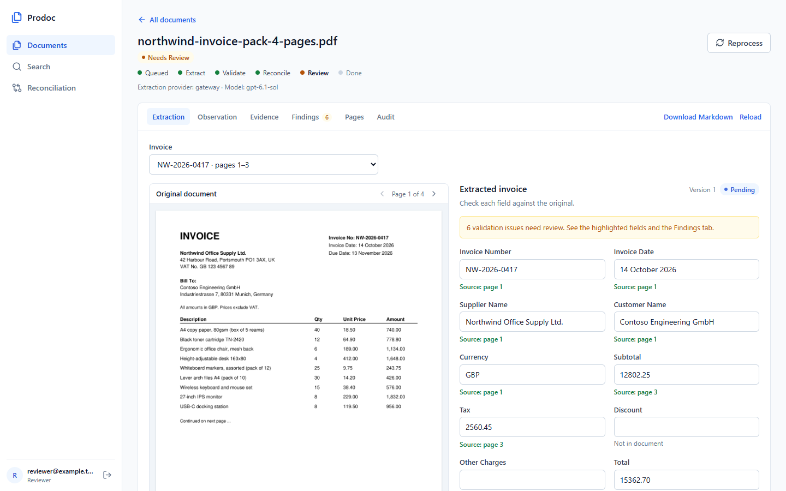
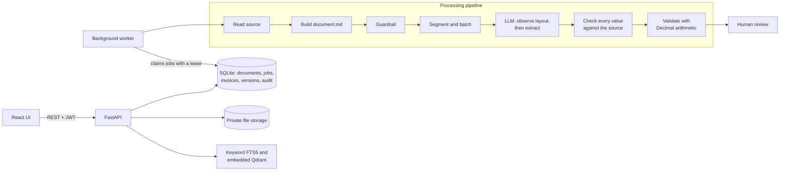

# Prodoc: AI Document Intelligence

Upload invoices in any common format. The system reads them, extracts structured data with an LLM, proves each value against the source, validates the arithmetic, and sends everything to a human for review.



## Measured results

Held-out synthetic test set, gateway model `gpt-6.1-sol`. Full report: [eval/reports/ai/report.md](eval/reports/ai/report.md).

| Metric | Old heuristic baseline | AI pipeline |
|---|---|---|
| Held-out documents processed (excluding the long PDF) | 27/27 | **27/27** |
| Invoice fields correct on those documents | 225/248 = 90.73% | **247/248 = 99.60%** |
| Line-item fields correct (AI only) | not comparable | **246/248 = 99.19%** |
| Line-item rows correct (AI only) | not comparable | **61/62 = 98.39%** |
| Extra 4-page, 2-invoice Northwind sample | not run | **16/16 fields correct** |
| Corrupt files rejected | 7/7 | **7/7** |
| Time per document (all 28) | p50 0.31 s, p95 6.33 s | **p50 50.5 s, p95 93.1 s** |

**How to read these numbers**

- The data is synthetic and its labels come from the same generator, so this is not real-world accuracy.
- All field errors are on `family-5-poor-scan.png`, the deliberately degraded scan.
- The report file adds the Northwind sample to its totals, so it reads 263/264 (99.62%) over 28 documents.
- Every AI invoice goes to human review by design, so the 0% false-accept rate proves nothing about detection quality.
- **The 1000-page PDF has not finished a full AI extraction.** It is planned into 167 requests of up to 6 invoices, each taking about 200 s, so the whole file needs roughly 2 to 3 hours of model time. 91 of the 167 requests are done and cached. Early attempts failed because 12-invoice batches took 316 s, over the gateway's 280 s limit, and the latest run stopped when the gateway account reached its usage limit. Reading the file (0.7 s) and planning it are measured.
- Long scanned PDFs still run through OCR as one pass, with no checkpoints.

## How it works



1. **Read.** Digital PDFs use their text layer. Scans and images use local MinerU OCR. CSV, XLS and XLSX use native readers that keep sheet, row and column positions.
2. **Guardrail.** Files with no financial content are rejected before any model call. Text that tries to instruct an AI is flagged and treated as data.
3. **Segment.** Long files are split into invoices and packed into batches. Finished requests are cached, so a retry resumes where it stopped.
4. **Extract.** The model first describes the layout, then extracts values and must cite the source block and exact quote for each one.
5. **Ground.** A value that can't be found in the cited source is nulled and flagged, so the model can't invent data.
6. **Validate.** Rules flag missing fields, bad numbers, total, subtotal, tax and line-item mismatches, and duplicates. Missing amounts are never assumed to be zero.
7. **Review.** A person compares the fields with the original, corrects them with a reason, and finalizes. Every change is versioned and audited.

More detail, including the database schema: [docs/architecture.md](docs/architecture.md).

## Run it

Tested on Windows 11 with Python 3.13 and Node 22, in PowerShell. **For daily commands, see [RUN.md](RUN.md).**

**1. Install the app**

```powershell
py -3.13 -m venv .venv
.\.venv\Scripts\python.exe -m pip install -r requirements.lock.txt
npm --prefix frontend ci
```

**2. Choose an LLM.** You need one of these:

```powershell
# Any OpenAI-compatible server: copy the template, then add your URL, token and model
copy backend\app\gateway_settings.example.py backend\app\gateway_settings.py
```

Or install [Ollama](https://ollama.com), run `ollama pull qwen3:4b-instruct-2507-q4_K_M`, and add `--provider local` in step 5. Local is free but much slower.

**3. Install OCR** (needed for scans and images only; digital PDFs and spreadsheets work without it):

```powershell
.\scripts\setup_mineru.ps1
```

**4. Create a login.** Enter a password of at least 12 characters when prompted:

```powershell
$env:DATABASE_URL = 'sqlite:///./var/docintel.db'
.\.venv\Scripts\python.exe -m backend.app.cli init-db
.\.venv\Scripts\python.exe -m backend.app.cli create-user --email reviewer@example.test --role reviewer
```

**5. Start the backend, then the frontend in a second terminal:**

```powershell
.\.venv\Scripts\python.exe run.py
npm --prefix frontend run dev
```

Open http://127.0.0.1:5173. API docs are at http://127.0.0.1:8000/docs. The embedding model downloads the first time documents are indexed.

To try it, run `.\.venv\Scripts\python.exe -m scripts.make_sample_invoice` and upload `var\samples\northwind-invoice-pack-4-pages.pdf`.

## API

| Purpose | Endpoint |
|---|---|
| Upload | `POST /api/v1/documents`, `POST /api/v1/documents/batch` |
| List and keyword filter | `GET /api/v1/documents`, `GET /api/v1/search` |
| Status | `GET /api/v1/documents/{id}/status` |
| Results | `GET /api/v1/documents/{id}/results` |
| Search | `POST /api/v1/search/smart`, `POST /api/v1/search/semantic` |
| Manual corrections | `POST /api/v1/invoices/{id}/corrections` |
| Finalize | `POST /api/v1/invoices/{id}/finalize` |
| Reprocess failed jobs | `POST /api/v1/documents/{id}/reprocess` |
| Page preview, audit, artifacts | `GET /api/v1/documents/{id}/preview/{page}`, `/audit`, `/artifacts/{name}` |
| Cross-verification | `POST /api/v1/reconciliations/run`, `GET /api/v1/reconciliations` |

## Design decisions

| Common choice | Used here | Why | Production path |
|---|---|---|---|
| Redis/BullMQ | Job queue in the SQL database, with leases and a separate worker | Jobs survive restarts and update in the same transaction as their document. One less service to run. The time goes to OCR and AI calls, not queue operations. | Postgres `SKIP LOCKED`, or Redis with Celery above that |
| PostgreSQL/MongoDB | SQLite in WAL mode | Zero setup for a reviewer, and the ORM keeps the app portable. It allows one writer at a time. | PostgreSQL. Triggers for it exist but **have not been run** |
| Vector database server | Qdrant in embedded mode with local BGE embeddings | Same engine with no server. Only the API process opens it. | Qdrant server through `QDRANT_URL`, **not tested with the current search code** |
| Cloud OCR | Local MinerU, with a fast path for digital text | Documents stay on the machine. Digital PDFs skip OCR entirely. | GPU workers |

Other decisions worth knowing:

- **Two LLM stages rather than one.** Observing the layout first handles spreadsheets with no fixed format, which a rule-based parser failed on (the baseline got 1/24 on key-value CSV).
- **No full RAG pipeline.** Extraction reads each invoice directly, because retrieval could drop a line item. Semantic search is used for finding documents.
- **Money is decimal text.** Values never pass through floating point.
- **A human finalizes everything.** Passing the arithmetic checks doesn't mean an invoice is correct.

## Tests

```powershell
.\.venv\Scripts\python.exe -m pytest backend/tests eval/test_eval.py -q
npm --prefix frontend test
```

Latest run: **269 backend and evaluation tests passed (80% coverage), 19 frontend tests passed, production build passed.** Saved results: [eval/reports/test-results.md](eval/reports/test-results.md). Model responses in these tests are mocked; real model accuracy comes from the evaluation.

To repeat the evaluation: `.\.venv-mineru\Scripts\python.exe -m eval.run_ai`.

## Known limits

- Not load-tested, and running several workers together has no throughput measurement.
- A typical document takes about 50 seconds, mostly OCR and model calls.
- Guardrail rejection is rule-based, so an unusual financial file can be rejected. Set `GUARDRAIL_RELEVANCE=flag` to flag rather than reject.
- Cross-verification compares two invoices you select; it doesn't match them automatically.
- Grounding proves a value exists in the source, not that it belongs to the right field.
- The `Dockerfile` has not been built, because Docker wasn't available on the development machine. It installs `requirements.txt` only, so it excludes MinerU.

## Documentation

| Topic | Where |
|---|---|
| Daily commands | [RUN.md](RUN.md) |
| Architecture and database schema | [docs/architecture.md](docs/architecture.md) |
| Requirements and evidence | [docs/requirements.md](docs/requirements.md) |
| Test results | [eval/reports/test-results.md](eval/reports/test-results.md) |
| Evaluation report | [eval/reports/ai/report.md](eval/reports/ai/report.md) |
| Walkthrough | [docs/walkthrough.md](docs/walkthrough.md) |
| Security | [SECURITY.md](SECURITY.md) |
| AI disclosure and licensing | [docs/ai-disclosure.md](docs/ai-disclosure.md) |
| Runtime and development prompts | [prompts/PROMPTS.md](prompts/PROMPTS.md) |
