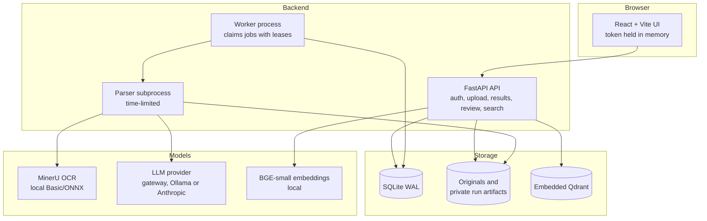
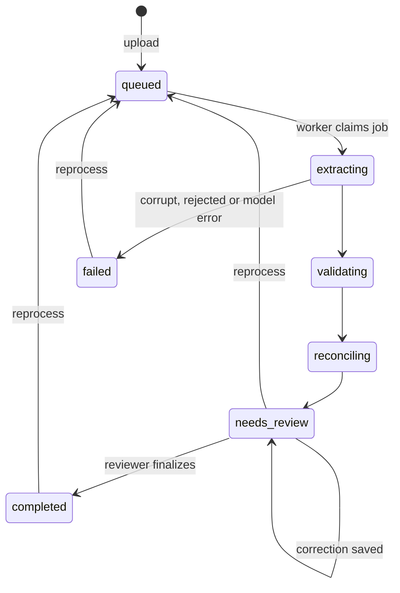
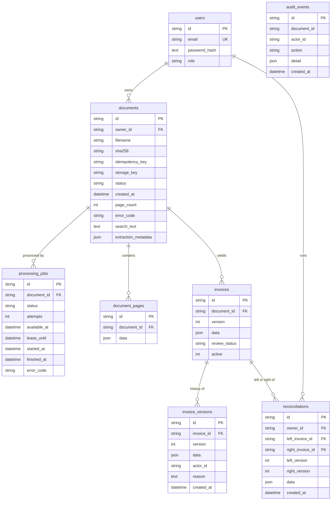

# Architecture and database schema

## Components

`run.py` starts the API from `.venv` and the worker from `.venv-mineru`. They need separate environments because MinerU's dependencies conflict with the API's. The worker never opens the embedded index: Qdrant's local mode allows one process, so the API indexes finished documents every 10 seconds.

## Document lifecycle

A worker holds a lease while it works. If it dies, an expired lease lets offline work retry, up to 3 attempts. AI work isn't resubmitted automatically, because the model call may already have been charged. A person reprocesses it, and the content-hash cache reuses finished requests.

## Pipeline

| Step | Code | What it does |
|---|---|---|
| Read | `backend/app/sources.py` | Returns blocks of text, each with an ID and location. Uses the PDF text layer when every page has one, otherwise MinerU. Native readers keep every CSV, XLS and XLSX cell with its coordinates. |
| Markdown | `docmarkdown.py` | Writes `document.md` for the model and for download, with anchors back to source blocks. |
| Guardrail | `guardrails.py` | Scores financial signals per page. Verdict is financial, uncertain or not financial. Rejects before any model call and flags instruction-like text. |
| Segment | `segmentation.py` | Skips irrelevant pages, splits by invoice, keeps continuations together and packs invoices into batches. |
| Extract | `observation.py`, `gateway_llm.py`, `local_llm.py` | Two stages with strict schemas: layout observation, then cited extraction. |
| Orchestrate | `parse_job.py` | Runs batches in parallel, caches by content hash and merges results. |
| Ground | `observation.py` | Rejects unknown sources, absent quotes, partial numbers and sign changes. Rejected values become null with a finding. |
| Validate | `financial.py` | Decimal checks for required fields, dates, currency, header totals, line arithmetic, and line-to-subtotal and tax aggregates. |
| Duplicates | `worker.py` | Links same supplier and number, or same supplier, date and total. Never deletes. |
| Search | `textsearch.py`, `search.py` | SQLite FTS5 trigram plus typo tolerance, and line-level semantic chunks with a score floor. |

### Long documents

A 1000-page file of one-page invoices is planned into 167 requests, each with up to 6 invoices or 24,000 characters. Six invoices is deliberate: twelve took 316 s to extract on the gateway, over its 280 s limit. A request takes about 200 s (observe about 47 s, extract about 150 s), so the whole file needs roughly 2 to 3 hours of model time. Three run at once by default, and one on Ollama; the gateway handled four to six at once in testing before its usage limit was reached. If a run is interrupted, reprocessing reuses cached answers. The gateway client retries temporary errors (408, 5xx, dropped connections) twice, waits longer through short rate limits, and gives up at once when the account's quota is spent. `run.py` allows up to two hours per document, which is shorter than this file needs; for a file this size, run the evaluation tool or raise `PROCESS_TIMEOUT_SECONDS` and `WORKER_LEASE_SECONDS`.

## Database schema

Executable definition: [`backend/app/db.py`](../backend/app/db.py).

| Data | Where it is stored |
|---|---|
| Document metadata | `documents` |
| Extracted text | `document_pages.data`, `documents.search_text` |
| Structured results | `invoices.data` |
| Validation errors | `invoices.data.findings` |
| Processing history | `processing_jobs`, `audit_events`, `invoice_versions` |

- `documents` is unique on owner + SHA-256 and on owner + idempotency key.
- `audit_events` has no foreign key, so its redacted history survives document deletion.
- Database triggers block changes to `audit_events` and `invoice_versions`. Audit rows also can't be deleted.
- Corrections use the version number to prevent lost updates.
- Schema creation uses `create_all`; there is no migration system.
- Money is stored as decimal text inside JSON, not as numeric columns.

## Scaling path

Measured today: one worker on a laptop CPU, about 50 seconds per document. Nothing here has been load-tested.

1. Move to PostgreSQL so several workers can write at once. Claim jobs with `SKIP LOCKED`.
2. Run the Qdrant server, so more than one process can use the index.
3. Add workers, with GPU workers for OCR.
4. Checkpoint OCR page by page, so a long scan can resume.
5. Put originals in object storage, so workers don't share a disk.
